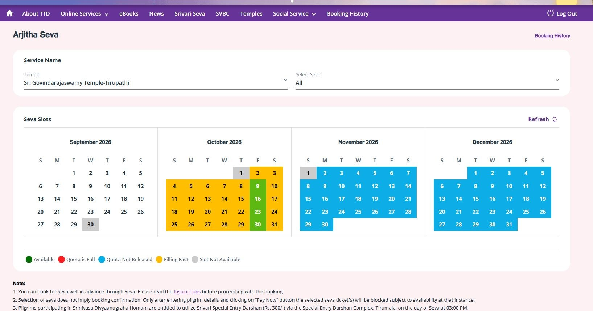
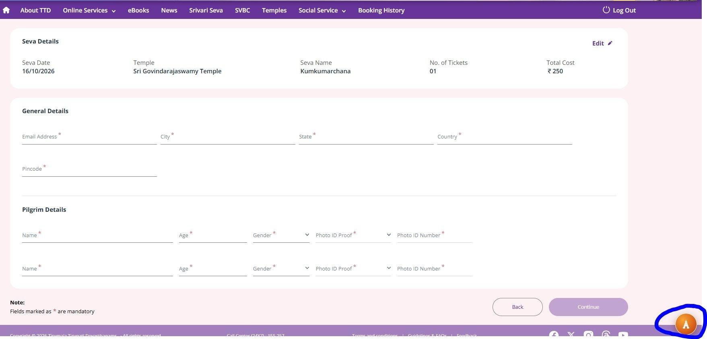
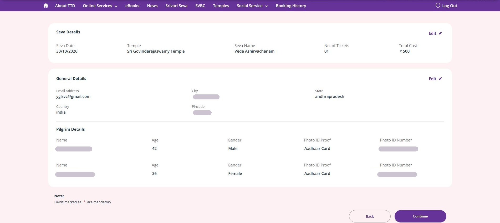

# TTD Pilgrim Autofill

**Fill TTD pilgrim details in about 3 seconds.**

TTD Pilgrim Autofill is a Google Chrome extension that fills the pilgrim details page of your Tirumala darshan or seva booking on the TTD website — names, age, gender and ID proof for up to 6 pilgrims — so you are not typing while the slots run out. You still log in, wait in the queue and pay yourself.

🌐 **Website:** https://subhaskarygtl.github.io/ttd-pilgrim-autofill-info/
✉️ **Request access:** [yglsvc@gmail.com](mailto:yglsvc@gmail.com?subject=TTD%20Pilgrim%20Autofill%20-%20Access%20request)

> This repository only hosts the information page. It contains no extension code and no downloads. The extension is shared privately — see [Request access](#request-access).

---

## Features

| | |
|---|---|
| ⚡ **3 pilgrims in ~3 seconds** | Names, age, gender and ID details go into every row at once. |
| 👨‍👩‍👧‍👦 **Up to 6 pilgrims** | Save your whole family or group once and fill every pilgrim in one booking. |
| 🪪 **Aadhaar & passport + visa** | Works with Aadhaar, and with passport and visa details for NRI and foreign pilgrims. |
| ✅ **Aadhaar typo check** | Flags an Aadhaar number that looks mistyped before it reaches the booking form. |
| 🔁 **Duplicate ID check** | Warns you if the same ID number is entered for two different pilgrims. |
| ⌨️ **Keyboard shortcuts** | <kbd>Alt</kbd>+<kbd>A</kbd> fills the form. <kbd>Alt</kbd>+<kbd>S</kbd> fills and moves on to the next step. |
| 🔘 **Floating button** | Prefer the mouse? A small floating button on the page fills everything with one click. |
| 🌙 **Dark mode** | Easy on the eyes while you wait for a late-night or early-morning slot release. |

## How it works

1. **Get access & install** — request access by email. Once approved, add the extension to Google Chrome on your computer.
2. **Save your pilgrims** — enter each pilgrim's name, age, gender and ID proof once. The typo and duplicate checks run here.
3. **Book on TTD as usual** — log in to the TTD website yourself, wait your turn in the queue and choose your darshan or seva slot.
4. **Press <kbd>Alt</kbd>+<kbd>A</kbd>** — on the pilgrim details page, press the shortcut or tap the floating button. Check the details, then continue and pay yourself.

## Screenshots

**1. You pick the slot** — choose your seva or darshan date on the TTD calendar yourself; the extension does not touch this step.

**2. One click on the pilgrim details page** — press <kbd>Alt</kbd>+<kbd>A</kbd> or click the floating button (circled) to fill every pilgrim at once.

**3. Filled and ready to review** — all details filled in seconds (personal details hidden here). Check them, then continue and pay yourself.

## Safety & fair use

It saves typing. It does not cheat.

- 🔒 **No login automation** — you sign in to TTD yourself. Your TTD password is never asked for or stored.
- 📱 **No OTP automation** — OTPs are read and typed by you.
- 🛡️ **No CAPTCHA solving** — you solve CAPTCHAs yourself, always.
- 💳 **No payment automation** — you review the booking and pay yourself. No card or UPI details are stored.
- ⏳ **Follows the TTD queue** — it does not skip or bypass TTD's waiting room.
- 💻 **Your data stays in your Chrome** — pilgrim details are saved locally in your own Chrome browser, not uploaded anywhere.

## Request access

TTD Pilgrim Autofill is shared privately and is not on the Chrome Web Store.

**Email: [yglsvc@gmail.com](mailto:yglsvc@gmail.com?subject=TTD%20Pilgrim%20Autofill%20-%20Access%20request)**

Send your name (and GitHub username, if you have one) and you will get access and setup steps. Please don't send Aadhaar or passport numbers by email — they are entered only inside the extension, on your computer.

## FAQ

**Is this an official TTD app?**
No. It is an independent tool and is not affiliated with or endorsed by Tirumala Tirupati Devasthanams (TTD). Bookings are always made on the official TTD website.

**Will it book darshan tickets for me automatically?**
No. It only fills the pilgrim details form. You log in, wait in the queue, pick the slot, enter the OTP, solve any CAPTCHA and pay — yourself.

**Which bookings does it help with?**
The pilgrim details step of TTD online bookings such as Special Entry Darshan and Arjitha Seva.

**How many pilgrims can I fill?**
Up to 6 pilgrims per booking. Three pilgrims fill in about 3 seconds.

**Which ID proofs are supported?**
Aadhaar, and passport with visa details for NRI and foreign pilgrims.

**Where is my pilgrims' data stored?**
Only in your own Chrome browser on your computer. It is not uploaded to any server.

**Does it work on mobile phones?**
No. Chrome extensions do not run in Chrome on Android or iPhone. Use Google Chrome on a Windows, Mac, Linux or ChromeOS computer.

**How do I get it?**
Email [yglsvc@gmail.com](mailto:yglsvc@gmail.com?subject=TTD%20Pilgrim%20Autofill%20-%20Access%20request) to request access.

---

© 2026 subhaskarygtl. All rights reserved. Independent tool, not affiliated with or endorsed by TTD.
